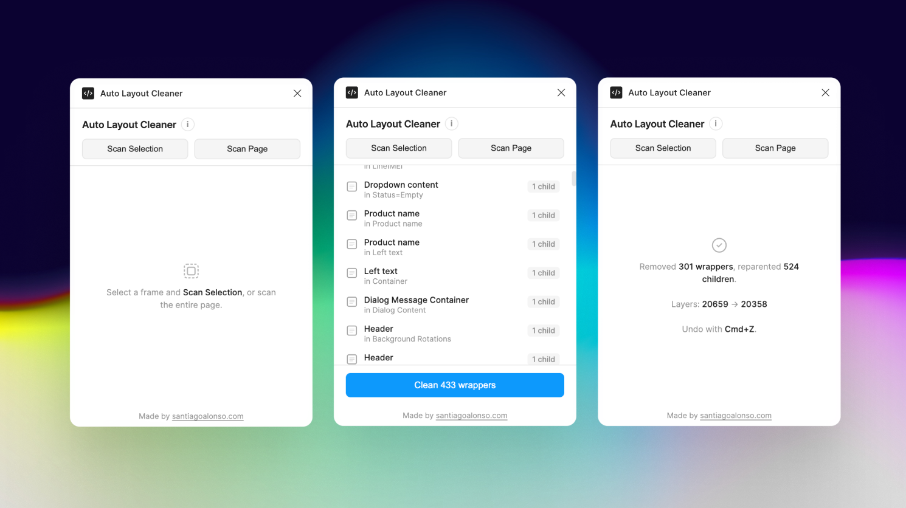

<p></p>

<h1>Auto Layout Cleaner</h1>

<p>Find and remove redundant wrapper frames in your autolayout hierarchies.<br>
One click to flatten. One undo to revert.</p>

<p><strong>Figma Plugin</strong></p>

<p>
  
  
  
</p>

<p><a href="https://www.figma.com/community/plugin/1608984541189092337/auto-layout-cleaner">Install from Figma Community</a></p>



## What It Does

Scans selected frames (or the entire page) for **redundant wrapper frames** – autolayout frames that sit between a parent and its content but add nothing visually. It reparents the children up to the grandparent and deletes the empty wrapper. The UI stays identical.

## What Counts as Redundant

A frame is flagged for removal when **all** of these are true:

- Type is `FRAME` (never touches instances, components, or component sets)
- Parent is also not an instance/component/component set
- Both the frame and its parent have autolayout enabled
- No visible fills, strokes, effects, or corner radius
- No padding on any side
- No clipping that the parent doesn't already have
- Opacity is 1, blend mode is normal/pass-through
- Has at least 1 child
- Visible, not absolutely positioned, and none of its children are absolutely positioned
- No prototype interactions or export settings
- **Single child:** a fixed-size wrapper only counts when the child already matches its size
- **Multiple children:** only redundant if the parent has the same layout direction, gap, wrap mode (and row gap when wrapping) and alignment, and the wrapper hugs its children along the parent's main axis

## Install

1. Clone or download this repo
2. In Figma Desktop: **Plugins > Development > Import plugin from manifest...**
3. Select the `manifest.json` file from this folder

## How to Use

1. Select the frame(s) you want to clean up
2. Run the plugin: **Plugins > Auto Layout Cleaner** (or **Plugins > Development** when running from this repo)
3. Click **Scan Selection** (or **Scan Page** for the whole page)
4. Review the list: click a wrapper to select and zoom to it on the canvas, and untick any you want to keep
5. Click **Clean X wrappers** to flatten the ticked ones
6. If anything looks wrong: **Cmd+Z** to undo everything in one step

## Limitations

- **Instances** – read-only, so the plugin can't reparent children inside them.
- **Main components** – off by default. Turn on **Also clean main components** to follow instances to their main component and clean it there. That changes every instance in the file, including ones outside your selection, and results inside a main component are labeled with its name.
- **Direction changers** – a horizontal frame inside a vertical parent is intentional structure, not redundancy
- **Gap changers** – frames with different `itemSpacing` than their parent create spacing groups on purpose

## Tests

The redundancy rules are covered by tests that run against a fake Figma API:

```bash
node --test tests/redundancy.test.js
```

## Feedback

Found a bug or have a feature idea? [Open an issue](https://github.com/madebysan/autolayout-cleaner/issues).

## License

[MIT](LICENSE)

---

Made by [santiagoalonso.com](https://santiagoalonso.com)
